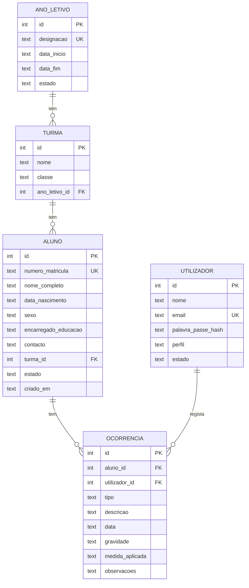

# Base de dados

SQLite, ficheiro local `database/caderneta.db` (ignorado pelo Git).
O esquema está em [`database/schema.sql`](../database/schema.sql) e é aplicado por `database/db.js`.

## Diagrama



## Restrições e regras de negócio

| Regra | Como é garantida |
|---|---|
| RN01 matrícula única | `UNIQUE` em `aluno.numero_matricula` |
| RN02 ocorrência com aluno e responsável | `NOT NULL` + FK para `aluno` e `utilizador` |
| RN03 vários registos por aluno | FK 1:N sem `UNIQUE` em `ocorrencia.aluno_id` |
| RN04 tipo, descrição e data obrigatórios | `NOT NULL` + `CHECK (length(trim(x)) > 0)` + data ISO válida |
| RN05 gravidade predefinida | `CHECK (gravidade IN ('leve','moderada','grave','muito_grave'))` |
| RN06 turma num ano letivo | `ano_letivo_id NOT NULL` + FK |
| RN07 preservar histórico | todas as FK com `ON DELETE RESTRICT` |
| RN11 email único | `UNIQUE COLLATE NOCASE` (ignora maiúsculas) |
| RN12 fim depois do início | `CHECK (data_fim > data_inicio)` |

## Notas de implementação

- **Chaves estrangeiras:** o SQLite tem-nas desligadas por omissão. `abrirBase()` executa `PRAGMA foreign_keys = ON` em cada ligação.
- **Datas:** guardadas como texto ISO (`AAAA-MM-DD`). O `CHECK (date(x) IS x)` rejeita formatos inválidos e datas impossíveis como `2025-02-30`.
- **Eliminação de alunos:** a base impede eliminar alunos com ocorrências. A API (V3) não terá `DELETE` para alunos, apenas alteração de `estado`.
- **Validação em duas camadas:** a base é a última defesa. O backend (V3 em diante) valida antes e devolve mensagens claras.

## Comandos

```bash
npm install        # instala better-sqlite3
npm run db:init    # cria database/caderneta.db com o esquema
npm test           # corre os testes da estrutura
```
